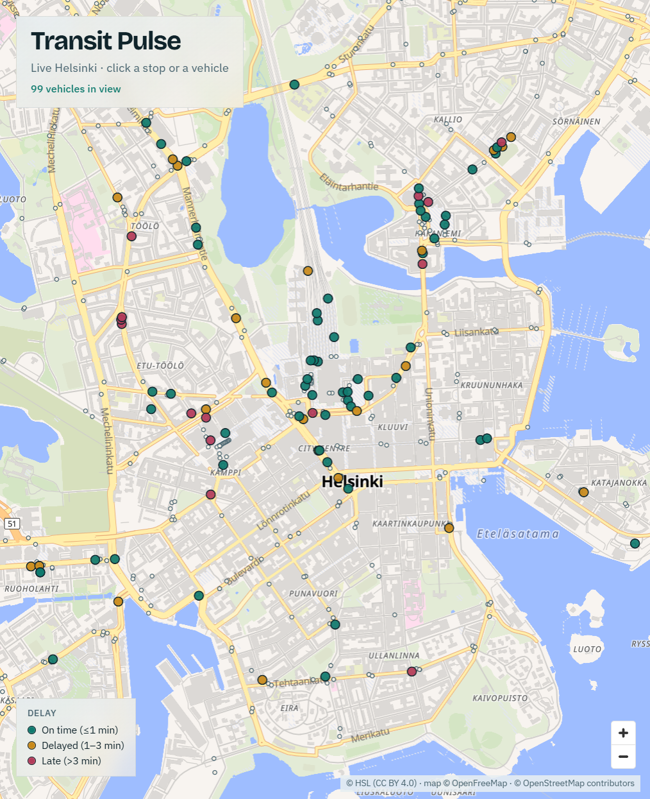

# Transit Pulse

Real-time public transport monitoring on open data from Helsinki (HSL), Bergen (Entur / Skyss) and Boston (MBTA).

## Status

Early development. Stages 1–2 are done: live data from the three cities has been collected since October 2026 (always-on archive VPS, phase A), and Helsinki positions are turned into stop events, delays and bunching anomalies. Stage 3 is storage, API and a live map (first demo locally; public compose is on-demand with archive replay — [ADR-0016](docs/adr/0016-run-the-public-demo-on-demand-with-archive-replay.md)). Progress is tracked in [milestones](https://github.com/starmucks/transit-pulse/milestones) and [docs/progress.md](docs/progress.md).

## What works today

- **Ingestor** (.NET 10, Native AOT) receives ten feeds: vehicle positions of the three cities, official arrival predictions, service alerts and weather. Every response is archived as received, in hourly Parquet + zstd files, so normalization can be re-run after a fix. A separate `hsl-stop` MQTT feed archives HSL’s own arrival/departure events as ground truth.
- Three adapters turn MQTT JSON, incremental SIRI XML and GTFS-Realtime protobuf into one `VehiclePosition` and publish it to the Kafka topic `positions.raw`, keyed by vehicle.
- **Worker** imports GTFS schedule snapshots into Postgres (versioned partitions) and upserts stop events from `events.stop` into `stop_events`.
- **Processor** (Helsinki) matches each position to its scheduled trip and route shape, detects stop arrivals/departures/passes, enriches delay, and emits bunching anomalies. State is checkpointed in Redis before Kafka offsets are committed; a kill/restart leaves the same `stop_events`. Unprocessable records go to a DLQ.
- **Replay** plays the archive back through the same pipeline at ×1…×50 or as fast as possible; a CI regression compares a tram-9 hour slice to golden stop events.
- Measured weekday peak: HSL ~1,540 MQTT messages/s, ~1,240 published positions/s across the three cities. Stop detection vs HSL ground truth and live Processor lag are in [docs/benchmarks.md](docs/benchmarks.md).
- **Live Helsinki map** (local Aspire + `web/`): vehicles over SignalR, stop arrivals, route punctuality. Source→map latency on 2026-11-26: **p50 7.3 s / p95 10.1 s** (n=1 141; goal C3 p95 &lt; 2 s not met yet — method and follow-up in [docs/benchmarks.md](docs/benchmarks.md)). Demo script: [docs/demo-stage-3.md](docs/demo-stage-3.md).



## What it will do

- Arrival predictions from a model trained on collected trip history, compared openly against the operators' own predictions.
- Plain-language explanations of delays, built only from real data (weather, incidents, service alerts).
- Telegram notifications for the lines and stops you care about.

## Data sources

| City | Operator | Format | Delivery |
|---|---|---|---|
| Helsinki | HSL | JSON (High-Frequency Positioning) | MQTT push |
| Bergen | Entur / Skyss | SIRI-VM XML | Incremental HTTP pull |
| Boston | MBTA | GTFS-Realtime protobuf | Full-snapshot HTTP pull |

All three are normalized into one model, so a new city means a new adapter only. Licences, attribution and access rules: [docs/data-sources.md](docs/data-sources.md).

Transit data: © HSL ([CC BY 4.0](https://creativecommons.org/licenses/by/4.0/)) · contains data under the Norwegian licence for Open Government data ([NLOD](https://data.norge.no/nlod/en/2.0)) distributed by Entur · MassDOT/MBTA (not affiliated or endorsed) · Fintraffic / digitraffic.fi (CC BY 4.0) · weather data by Open-Meteo.com (CC BY 4.0). Data has been processed and normalized by Transit Pulse.

## Build and test

Requires the [.NET 10 SDK](https://dotnet.microsoft.com/download/dotnet/10.0).

```shell
dotnet build TransitPulse.slnx
dotnet test --solution TransitPulse.slnx
```

## Run locally

Requires Docker. The AppHost starts PostgreSQL (TimescaleDB + PostGIS), Redis, Redpanda and Redpanda Console; the dashboard opens at https://localhost:17100.

```shell
dotnet dev-certs https --trust
dotnet user-secrets set "Parameters:postgres-password" "<value>" --project src/TransitPulse.AppHost
dotnet user-secrets set "Parameters:redis-password" "<value>" --project src/TransitPulse.AppHost
dotnet run --project src/TransitPulse.AppHost
```

The Postgres password is written into the data volume on first start. To change it later, also remove the volume: `docker volume rm transit-pulse-postgres` (this deletes local data).

The AppHost also runs the Ingestor in `full` mode (archives to `data/archive/`, publishes to `positions.raw`), the **Processor** (enriched positions, stop events, anomalies), the **Worker** (GTFS import and `StopEventSink`), the **API**, and the Vite **web** live map (MapLibre + SignalR). Topics are visible in Redpanda Console. Frontend details: [web/README.md](web/README.md).

### Ingestor modes and archive tools

`Ingestor:Mode` selects what the Ingestor does:

| Mode | What it does |
|---|---|
| `archive` (default) | Collects all feeds into the raw archive; no Kafka. This is how the collector server runs. |
| `full` | Archive plus normalization and publishing to `positions.raw`. |
| `replay` | Reads `Replay:From` … `Replay:To` from the archive and publishes positions at `Replay:Speed` (0 = as fast as possible, or 1–50); optional `Replay:Feeds` limits the feeds. |

Archive tools (run the Ingestor with these arguments; dates are UTC days, the second one exclusive):

```shell
dotnet run --project src/TransitPulse.Ingestor -- --stats data/archive
dotnet run --project src/TransitPulse.Ingestor -- --profile data/archive 2026-10-22 2026-10-29
dotnet run --project src/TransitPulse.Ingestor -- --profile-positions data/archive 2026-10-22 2026-10-29
```

Deploying the collector to a Linux server (systemd, Native AOT binary): scripts in [deploy/collector/](deploy/collector/), starting with `publish.sh` and `install.sh`.

## Documentation

- [Project brief](PROJECT_BRIEF.md) (in Russian): goals, architecture, work plan.
- [Stage specifications](docs/stages/).
- [Architecture decisions](docs/adr/).
- [Benchmarks](docs/benchmarks.md): measured numbers with method.

## License

[MIT](LICENSE)
